# Habla Fluido

App Flutter para aprender inglés con un tutor de IA (Flutter + Node).

## 📱 Capturas de la app

### Inicio

Muestra nivel, racha, plan del día y repasos pendientes.

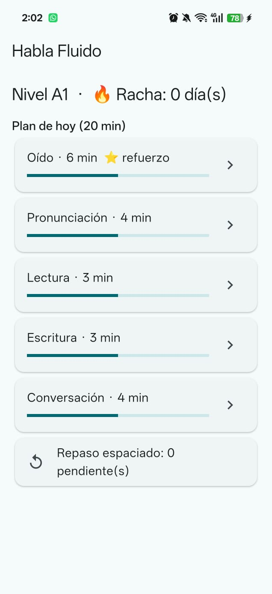

### Pronunciación (shadowing)

Escuchas el modelo, lo repites y la app compara lo que reconoció.

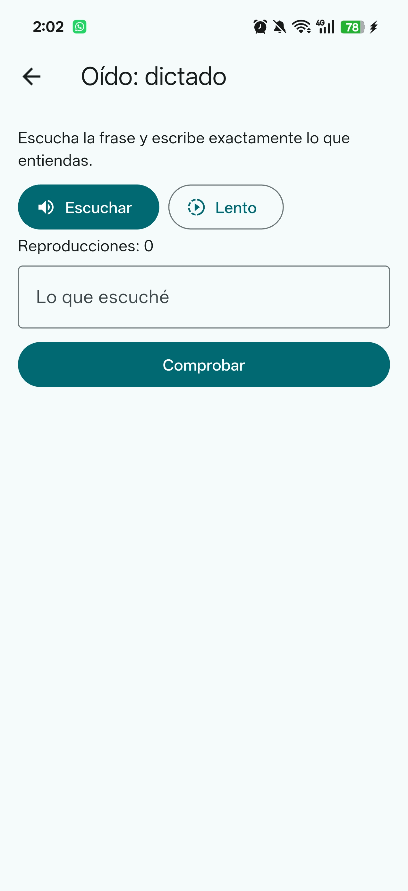

### Oído: dictado

Escuchas, escribes y comparas palabra por palabra.

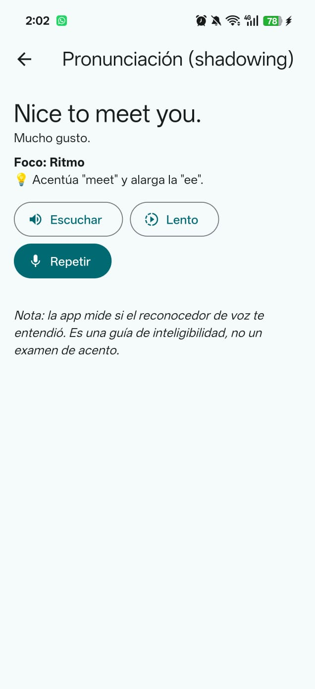

### Conversación con el tutor

El tutor responde al contenido, corrige poco y termina con una pregunta.

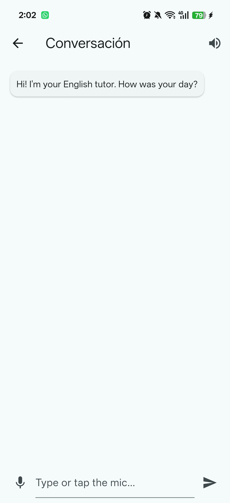

### Repaso espaciado

Dices la frase en inglés antes de ver la respuesta y te autocalificas.

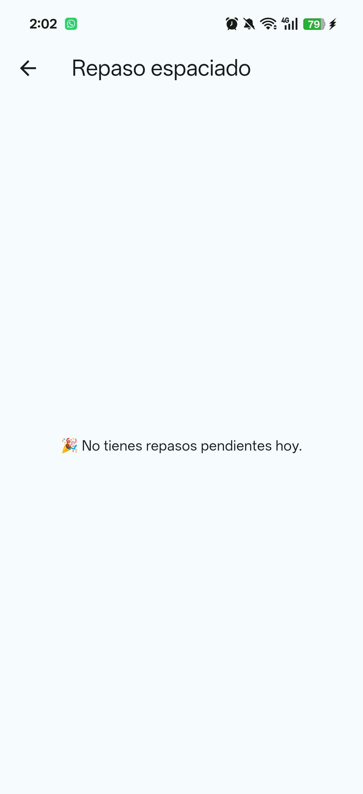

## Evidencia TDD

### Ronda 2 - Comparador
ROJO: 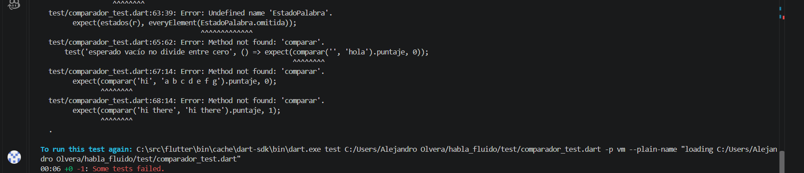
VERDE: 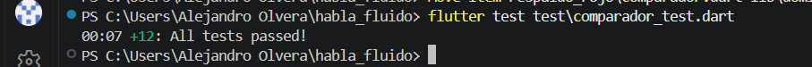

### Rondas 3 y 4 - Repaso SM-2, progreso y plan diario
ROJO: 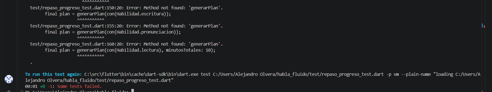
VERDE: 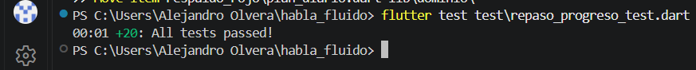

### Ronda 6 - Proxy
ROJO: 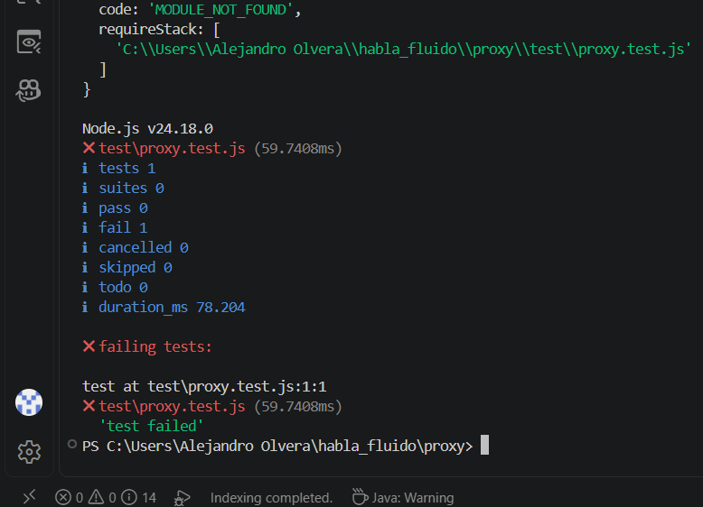
VERDE: 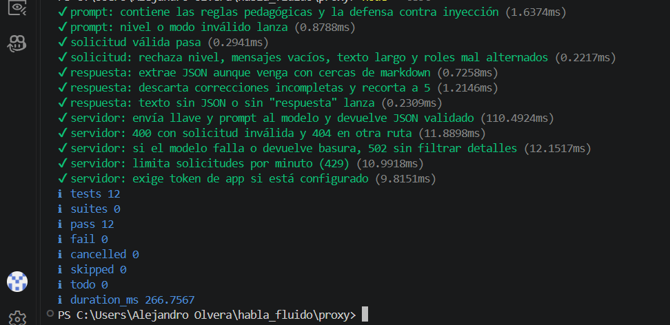

### Ronda 7 - Tutor simulado y cliente HTTP
ROJO: 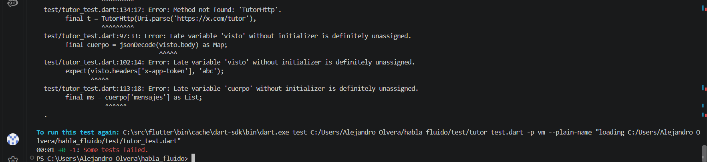
VERDE: 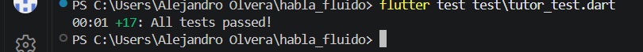

### Ronda 9 - ViewModels
ROJO: 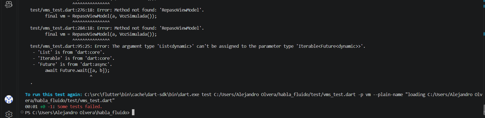
VERDE: 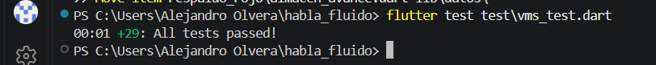

### Resultado final
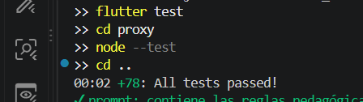